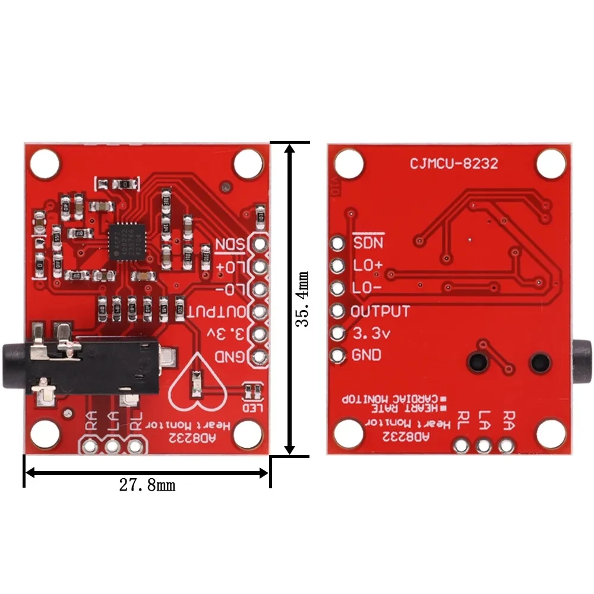
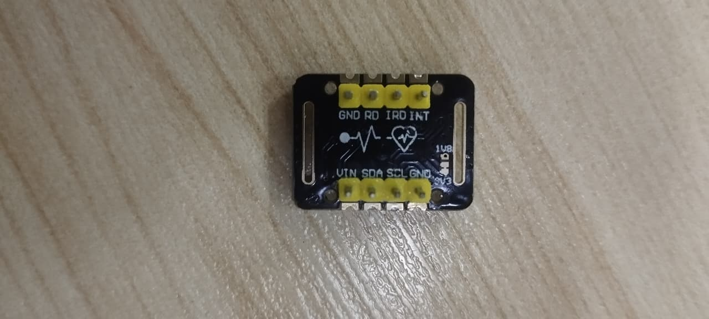

# Hardware Pinout & Single-MCU Integration Guide

## Overview

This document specifies the hardware connections and pin functions for the **Single-MCU ESP32-S3** architecture in the **Latency-Aware Fog Node Selection (LFNS)** Remote Health Tracking System.

The ATmega328P has been removed from the architecture. All analog bio-potential digitization, R-peak detection, I2C optical pulse oximetry, blood pressure aggregation, and Wi-Fi transmissions are handled exclusively by **one ESP32-S3 Development Board**.

Furthermore, **all sensors are wired exclusively to the Left Row of Pins of the ESP32-S3** to ensure clean, side-by-side breadboard wiring without crossover jumpers.

---

## Visual Reference & Module Archives

* `docs/images/ad8232_ecg_module.png` — AD8232 ECG Sensor module.
* `docs/images/esp32_s3_dev_board.png` — ESP32-S3 44-pin development board layout.
* `docs/images/max30102_sensor_back_pinout.jpeg` — MAX30102 HW-805 rear silkscreen showing the exact numbered pin layout (`VIN`, `SDA`, `SCL`, `GND`, `INT`, `IRD`, `RD`).
* `docs/images/max30102_sensor_front.png` — MAX30102 sensor optical front side.

---

## 1. ESP32-S3 Left-Side Pin Verification

The user specifically requested utilizing the left-side pin row:
`3.3V, 3.3V, RST, 4, 5, 6, 7, 15, 16, 17, 18, 8, 3, 46, 9, 10, 11, 12, 13, 14, 5Vin, GND`.

### Does this left-side row work for everything? **YES, 100% PERFECTLY!**
Here is why:
1. **Power rails are natively available:**
   * Pin 1 (`3.3V`) and Pin 2 (`3.3V`) supply power to both sensors.
   * Pin 22 (`GND`) provides common system ground.
2. **Wi-Fi + ADC independence:**
   * On the ESP32, ADC2 cannot be used while Wi-Fi transmits. However, **`GPIO4` is on ADC1 (`ADC1_CH3`)**, which works continuously during active Wi-Fi telemetry without conflict.
3. **Hardware I2C routing:**
   * The ESP32-S3 GPIO matrix allows hardware I2C to be mapped to **`GPIO8` (SDA)** and **`GPIO9` (SCL)** without any bus degradation.
4. **Hardware Interrupt for FIFO:**
   * **`GPIO10`** supports external falling-edge interrupts for the MAX30102 data-ready line (`INT`).
5. **Hardware UART for NIBP:**
   * **`GPIO16` (RX1)** and **`GPIO17` (TX1)** provide dedicated Hardware UART1 for blood pressure readings.

---

## 2. Pin-by-Pin Hardware Breakdown

### A. AD8232 Heart Monitor Module (ECG)

| Pin Label | Type | Voltage | Description & Function | Connected ESP32-S3 Pin (Left Side) | Role in System |
|---|---|---|---|---|---|
| **GND** | Power | 0V | Ground reference | **`GND` (Pin 22)** | Common electrical ground. |
| **3.3v** | Power | 3.3V DC | Positive power rail (~170 µA current) | **`3.3V` (Pin 1 or 2)** | Power supply from onboard LDO. *Never connect to 5V!* |
| **OUTPUT** | Analog Out | 0V – 3.3V | Amplified & filtered analog cardiac bio-potential | **`GPIO4` (Pin 4, ADC1_CH3)** | Sampled at 250 Hz by ADC1 on Core 0 for Pan-Tompkins R-peak detection. |
| **LO-** | Digital Out | 3.3V Logic | Leads-Off Detector Minus (Active HIGH) | **`GPIO6` (Pin 6)** | Alerts if Left Arm (LA) electrode disconnects from skin. |
| **LO+** | Digital Out | 3.3V Logic | Leads-Off Detector Plus (Active HIGH) | **`GPIO5` (Pin 5)** | Alerts if Right Arm (RA) electrode disconnects from skin. |
| **SDN** | Digital In | 3.3V Logic | Shutdown control (Active LOW, < 1 µA sleep) | **NC or tied to `3.3V`** | Keep module powered on for continuous monitoring. |
| **RA, LA, RL**| Biomedical | Microvolts | Right Arm, Left Arm, Right Leg Drive pads | Patient Electrodes | `RL` actively cancels 50/60 Hz mains electrical noise. |

---

### B. MAX30102 Pulse Oximeter & Heart Rate Module (HW-805)

The rear silkscreen of the HW-805 module features two 4-pin headers:
* **Bottom row:** `VIN`, `SDA`, `SCL`, `GND`
* **Top row:** `GND`, `RD`, `IRD`, `INT`

| Pin Label | Header Row | Type | Description & Function | Connected ESP32-S3 Pin (Left Side) | Role in System |
|---|---|---|---|---|---|
| **VIN** | Bottom | Power | Power supply input (3.3V – 5.0V) | **`3.3V` (Pin 1 or 2)** | Powers the onboard 1.8V LDO and LED drivers. |
| **GND** | Bottom / Top | Power | Electrical ground | **`GND` (Pin 22)** | Common ground reference. |
| **SDA** | Bottom | I2C Data | Serial Data line (open-drain with pull-ups) | **`GPIO8` (Pin 12)** | Hardware I2C SDA bus line. Reads 32-sample FIFO buffer. |
| **SCL** | Bottom | I2C Clock | Serial Clock line (up to 400 kHz) | **`GPIO9` (Pin 15)** | Hardware I2C SCL bus line. |
| **INT** | Top | Digital Out | Active-LOW hardware interrupt | **`GPIO10` (Pin 16)** | Configured with `INPUT_PULLUP` and falling-edge interrupt. Asserts when new sample is ready. |
| **IRD** | Top | Analog Test | Cathode test pad of Infrared LED (880 nm) | **NC (Unconnected)** | Factory test pad. |
| **RD** | Top | Analog Test | Cathode test pad of Red LED (660 nm) | **NC (Unconnected)** | Factory test pad. |

---

### C. NIBP (Blood Pressure) Interface

| Pin Label | Type | Description | Connected ESP32-S3 Pin (Left Side) | Role in System |
|---|---|---|---|---|
| **TX** | Digital Out | NIBP UART Transmit | **`GPIO16` (Pin 9, U1RXD)** | Receives systolic, diastolic, and MAP readings. |
| **RX** | Digital In | NIBP UART Receive | **`GPIO17` (Pin 10, U1TXD)** | Sends command triggers (start inflation, abort). |
| **GND** | Power | Ground | **`GND` (Pin 22)** | Common ground. |

---

## 3. Complete Single-Side Breadboard Wiring Map

Every single wire connects to the **Left Header** of the ESP32-S3:

| Left Pin # | Left Header Pin Label | Connected Module & Pin | Function |
|---|---|---|---|
| **1** | `3.3V` | AD8232 `3.3v` & MAX30102 `VIN` | Shared 3.3V Power Rail |
| **2** | `3.3V` | Auxiliary 3.3V (or tied to SDN) | Power Rail |
| **3** | `RST` | Hardware Reset Button | Open / Manual reset |
| **4** | `GPIO4` | **AD8232 `OUTPUT`** | **Analog ECG Signal (ADC1_CH3)** |
| **5** | `GPIO5` | **AD8232 `LO+`** | **Leads-Off Right Detach Alert** |
| **6** | `GPIO6` | **AD8232 `LO-`** | **Leads-Off Left Detach Alert** |
| **7** | `GPIO7` | Spare / Optional AD8232 `SDN` | Sleep mode control |
| **8** | `GPIO15` | Spare GPIO | Available |
| **9** | `GPIO16` | **NIBP `TX`** | **Hardware UART1 RX** |
| **10** | `GPIO17` | **NIBP `RX`** | **Hardware UART1 TX** |
| **11** | `GPIO18` | Spare GPIO | Available |
| **12** | `GPIO8` | **MAX30102 `SDA`** | **Hardware I2C Data** |
| **13** | `GPIO3` | Spare ADC1 pin | Available |
| **14** | `GPIO46` | Input-only Strapping Pin | Unused |
| **15** | `GPIO9` | **MAX30102 `SCL`** | **Hardware I2C Clock** |
| **16** | `GPIO10` | **MAX30102 `INT`** | **FIFO Interrupt (Active-LOW)** |
| **17** | `GPIO11` | Spare GPIO | Available |
| **18** | `GPIO12` | Spare GPIO | Available |
| **19** | `GPIO13` | Spare GPIO | Available |
| **20** | `GPIO14` | Spare GPIO | Available |
| **21** | `5Vin` | 5V USB / Battery Input | Power input to board |
| **22** | `GND` | AD8232 `GND` & MAX30102 `GND` | Shared Ground Rail |

---

## 4. Dual-Core FreeRTOS Processing Pipeline

With the ATmega328P eliminated, the ESP32-S3's dual 240 MHz cores partition the workload effortlessly:

* **Core 0 (High Priority Real-Time Deterministic Task):**
  * Hardware Timer runs at **250 Hz (every 4 ms)**.
  * Reads 12-bit ADC value from `GPIO4` (`ADC1_CH3`).
  * Applies digital bandpass filter (0.5 Hz – 40 Hz) and Pan-Tompkins squaring/moving window integrator.
  * Detects R-peaks, calculates RR-interval, and pushes valid beats into an internal FreeRTOS queue (`xQueueECG`).
* **Core 1 (Peripherals & Wi-Fi Communication Task):**
  * Reads PPG samples from MAX30102 over I2C (`GPIO8/9`) when interrupted on `GPIO10`.
  * Computes blood oxygen saturation ($\text{SpO}_2\%$) and pulse rate.
  * Formats decoupled telemetry JSON payload.
  * Sends requests over Wi-Fi 802.11 b/g/n to the Local Gateway where **LFNS** executes node selection.
